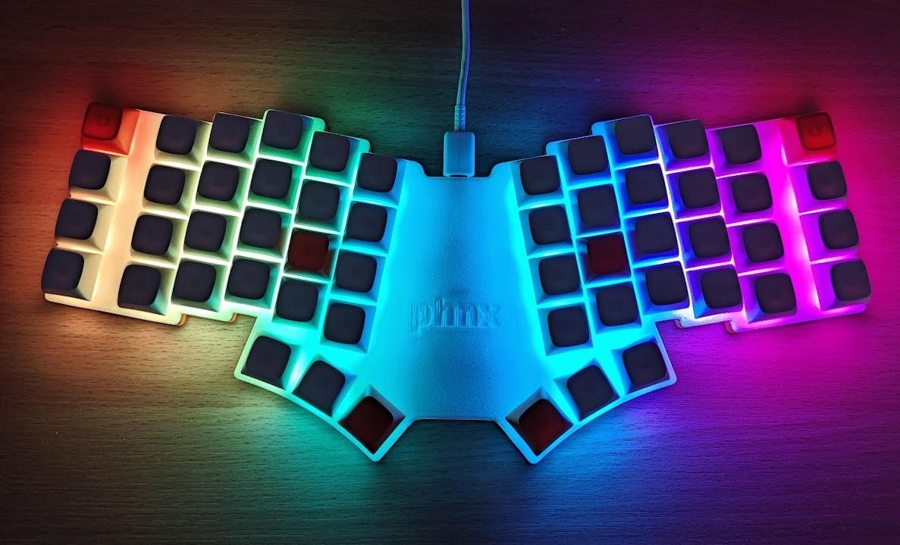
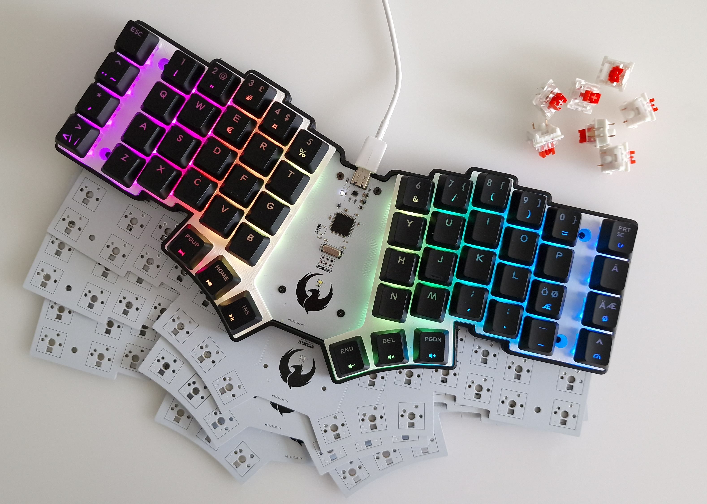
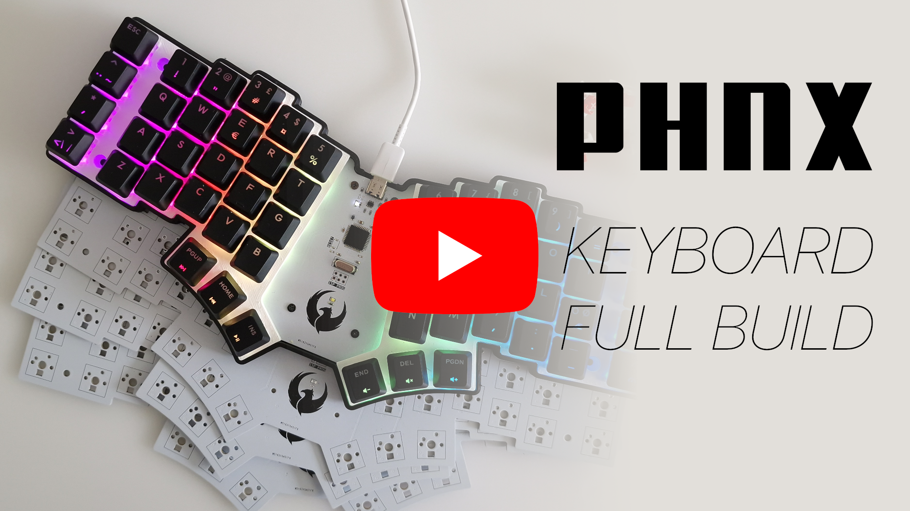
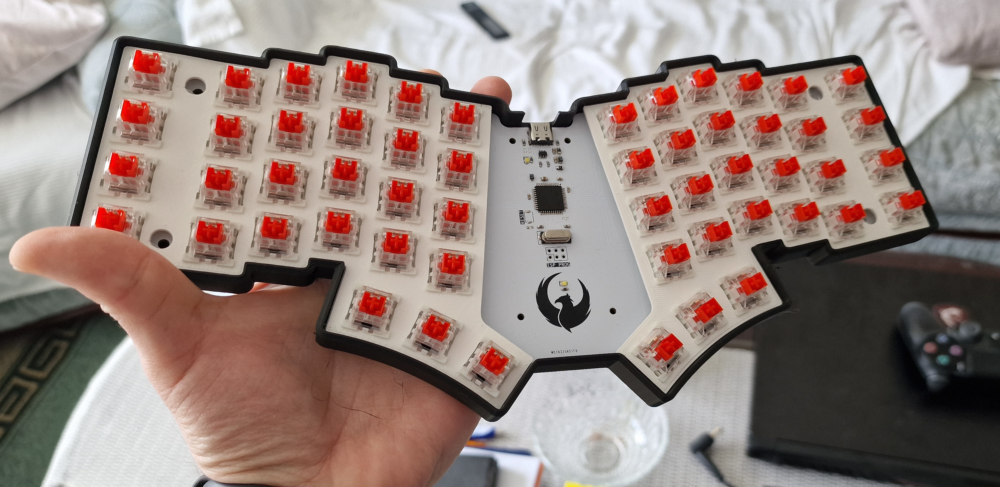
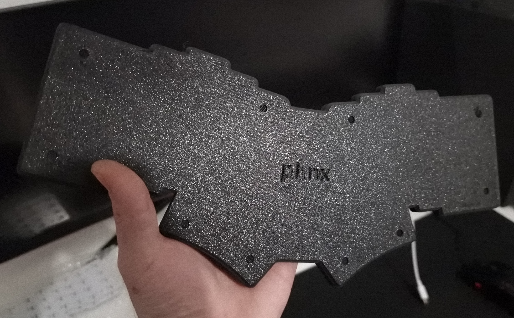
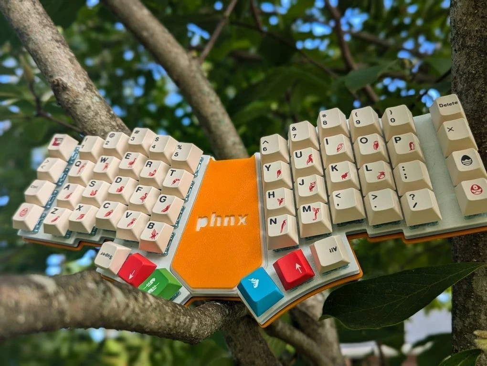
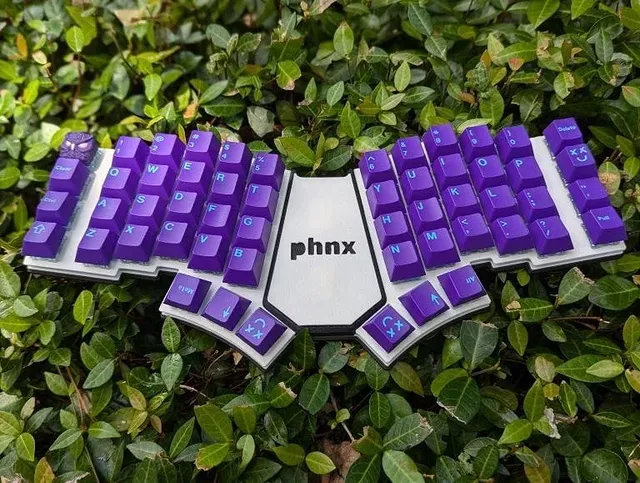

# PHNX Keyboard

PHNX is an ergonomic keyboard featuring 54 MX compatible switches. It is inspired by the Miryoku layout and includes one additional row at the top along with macro keys on both sides. Powered by the famous ATMega32U4 microcontroller, it features a Type C connector with ESD protection.

The keyboard is using QMK software and features an addressable LED on each key. Designed using KiCad 8, the boards were sponsored by [PCBWay](https://pcbway.com/), known for their excellent PCB manufacturing capabilities.

## Project Structure

The project repository is structured as follows:

- **`kicad/`**: Contains PCB design files and schematics.
- **`gerbers/`**: Includes Gerber files essential for manufacturing.
- **`fimware/`**: Includes PHNX keyboard mappings and QMK files. This folder should be copied to your QMK directory and renamed to 'phnx'.
- **`case/`**: Consists of 3D print files for both the switch plates and the back cover of the keyboard.

The schematic is available in PDF format in the **`kicad/`** directory.

## Build Process

For a comprehensive overview of the schematic, board layout, and the build process, please refer to the following YouTube video:

## 3D Printed Parts

The case consists of two 3D printed parts. The two plates for each side to put switches on, and the bottom case which will fit the boards. The case has space for installing rubber pads for better grip.

## Setup

## Contributing

Contributions to PHNX are welcome! Before making any changes, please ensure to open an issue to discuss the proposed modifications.
